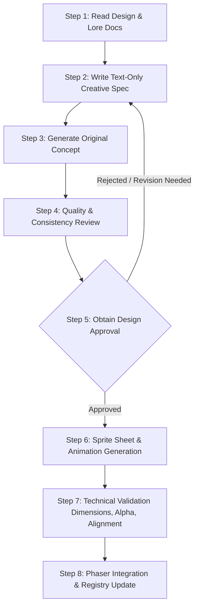

# CHRONO – THE FRACTURED DIVINITY

## Original Asset Creation Policy & Pipeline Specification

**Version:** 1.0.0  
**Effective Date:** Project Inception  
**Scope:** All visual (characters, creatures, environments, UI, effects) and auditory assets.

---

## 1. Core Principle

All original character, creature, environment, and item designs must originate strictly from written creative specifications established in the project's Game Design Document ([GDD.md](GDD.md)), Lore Bible ([LORE.md](LORE.md)), and Art Guide ([ART_GUIDE.md](docs/art/ART_GUIDE.md)).

No visual asset may enter production without a documented text-only specification.

---

## 2. Prohibited Workflows

To guarantee 100% original copyright integrity, the following actions are strictly prohibited:

- **NO Visual Reference Search:** Do not search for, download, scrape, or reference existing commercial, indie, or copyrighted character images, sprite sheets, or concept art.
- **NO Image-to-Image / Screenshot Inputs:** Do not feed existing game screenshots, fan art, or proprietary concept art into image-generation tools or vision models.
- **NO Artist / Franchise Imitation Prompts:** Prompts must never request styles in the likeness of identifiable living artists, copyrighted franchises, studios, or specific IP characters (e.g., "in the style of Chrono Trigger", "looks like Link", etc.).
- **NO Silent Replacements:** Never replace an approved asset with an unreviewed or unrelated asset.
- **NO Unidentified Placeholders:** Temporary placeholder assets must never be passed off or treated as final approved artwork.
- **NO Automated Generation Calls:** Do not call Stable Diffusion or any other image-generation model/API. Image generation with Stable Diffusion is strictly manual: the Coding Agent writes text prompts and setting recommendations, and the user generates and selects the image.
- **Exception – Code-Authored Pixel Art (Pipeline B, owner-approved 2026-11-11):** The Coding Agent may place pixels explicitly in a committed script (see AGENTS.md §5). Output is a candidate like any other and passes the same validation and approval stages below.

---

## 3. Manual Stable Diffusion Pipeline & Approval Stages

### The Manual Workflow:

1. **Coding Agent:** Reads character design documents ([PETER_DESIGN.md](docs/art/PETER_DESIGN.md), [ART_GUIDE.md](docs/art/ART_GUIDE.md)).
2. **Coding Agent:** Writes a text-only generation prompt.
3. **Coding Agent:** Saves the prompt to `art-source/characters/peter/prompts/`.
4. **Coding Agent:** Specifies the Stable Diffusion settings (model, sampler, CFG, steps, dimensions) to record.
5. **User:** Manually executes the prompt in Stable Diffusion, selects the best result, and adds the PNG to `art-source/characters/peter/generated/candidates/`.
6. **Coding Agent:** Inspects the selected PNG, validating dimensions, transparency, silhouette, and consistency against `peter_concept_v1.png`.
7. **User & Coding Agent:** Promotes approved assets to `art-source/characters/peter/generated/approved/`.
8. **Coding Agent:** Prepares sprite atlases and integrates approved assets into `public/assets/characters/peter/` for Phaser.

### The 4 Approval Stages:

- **Candidate:** Raw image placed in `generated/candidates/`.
- **Under Review:** Being inspected for silhouette, curl definition, palette, and transparency.
- **Approved:** Explicit user approval granted; archived in `generated/approved/`.
- **Integrated:** Deployed into `public/assets/` and configured in Phaser.

---

## 4. Required 8-Step Asset Pipeline

### Step 1: Read the Relevant Design Document

Review [GDD.md](GDD.md), [LORE.md](LORE.md), and [ART_GUIDE.md](docs/art/ART_GUIDE.md) to understand the entity's narrative role, faction, physical characteristics, silhouette requirements, and emotional tone.

### Step 2: Create a Text-Only Generation Specification

Author an exhaustive, descriptive textual specification detailing:

- Narrative identity and role.
- Anatomy, head-to-body proportions (1:2.5 to 1:3 stylized realism).
- Garments, materials, textures, and physical equipment.
- Color palette restricted to the 32-color Chronal Spectrum (hex values).
- Lighting, highlight placement, and shadow behavior.
- Specific silhouette hallmarks (e.g., crystalline fracture core, visor shape).

### Step 3: Generate an Original Concept

Produce the original visual concept utilizing only the text-only specification authored in Step 2.

### Step 4: Review Silhouette, Proportions, Colors, and Consistency

Audit the output against the criteria in [ART_GUIDE.md](docs/art/ART_GUIDE.md):

- **Silhouette Test:** Recognizable shape when blacked out against white.
- **Proportions:** Bounding box adheres to dimensional limits (e.g., $32 \times 32\text{ px}$).
- **Palette Integrity:** Colors conform to the Chronal Spectrum swatches without automatic gradients.
- **No Stray Artifacts:** Pure pixel boundaries, no fuzzy anti-aliasing or stray half-opacity pixels.

### Step 5: Obtain Design Approval

Present the concept alongside its text-only specification and review checklist. Record approval in [ASSET_REGISTRY.md](ASSET_REGISTRY.md).

### Step 6: Generate Sprite Sheets & Animation Variations

Once the static concept is approved, derive the 4-directional poses and animation frames (idle, walk, action) adhering strictly to the approved design.

### Step 7: Technical Validation

Verify that:

- Background is 100% transparent (8-bit alpha channel).
- Frame dimensions are uniform ($32 \times 32\text{ px}$ or designated grid).
- Ground anchor point aligns with the physics bounding box ($18 \times 14\text{ px}$ foot collider).
- Animation frame names follow `<category>_<entity_id>_<action>_<direction>_<frame>.png`.

### Step 8: Integrate into Phaser & Update Registry

Add asset files into `public/assets/`, register them in `PreloadScene.ts`, and update their entry in [ASSET_REGISTRY.md](ASSET_REGISTRY.md) with full versioning metadata.

---

## 4. Asset Versioning & Registry Standards

Every asset in the project must be tracked in [ASSET_REGISTRY.md](ASSET_REGISTRY.md) with the following mandatory metadata schema:

| Metadata Field           | Description                                                                                           |
| ------------------------ | ----------------------------------------------------------------------------------------------------- |
| **Asset ID**             | Unique uppercase identifier (e.g. `CHAR_VESSEL_001`, `MOB_SHADE_001`)                                 |
| **Object Name**          | Human-readable name of the character, environment piece, or object                                    |
| **Design Doc Version**   | Version of [GDD.md](GDD.md) or [LORE.md](LORE.md) governing the design                                |
| **Status**               | `PLACEHOLDER_TEMPORARY` \| `SPEC_DRAFTED` \| `CONCEPT_PENDING_APPROVAL` \| `APPROVED` \| `DEPRECATED` |
| **Text Specification**   | Pointer or full text of the approved text-only prompt / creative brief                                |
| **Model & Version**      | Image generation model or procedural tool identifier (if applicable)                                  |
| **Seed / Params**        | Random seed or generation parameters (if supported)                                                   |
| **Output Dimensions**    | Canvas size (e.g. $32 \times 32\text{ px}$) and frame count                                           |
| **Animation Frame Spec** | Breakdown of frames per direction and action loop                                                     |
| **Approval Record**      | Date, approver, and approval milestone                                                                |

---

## 5. Placeholder Protocol

1. All assets generated during early prototyping are explicitly designated `STATUS: PLACEHOLDER_TEMPORARY`.
2. File paths and asset keys for placeholders must clearly indicate temporary status (e.g., `player_placeholder.png`, `silence_placeholder.wav`) or be explicitly logged in the registry.
3. Placeholder assets must never be mistaken for approved final art.
4. The Coding Agent must never invent an unauthorized replacement for an approved design without an updated text specification and explicit user approval.
