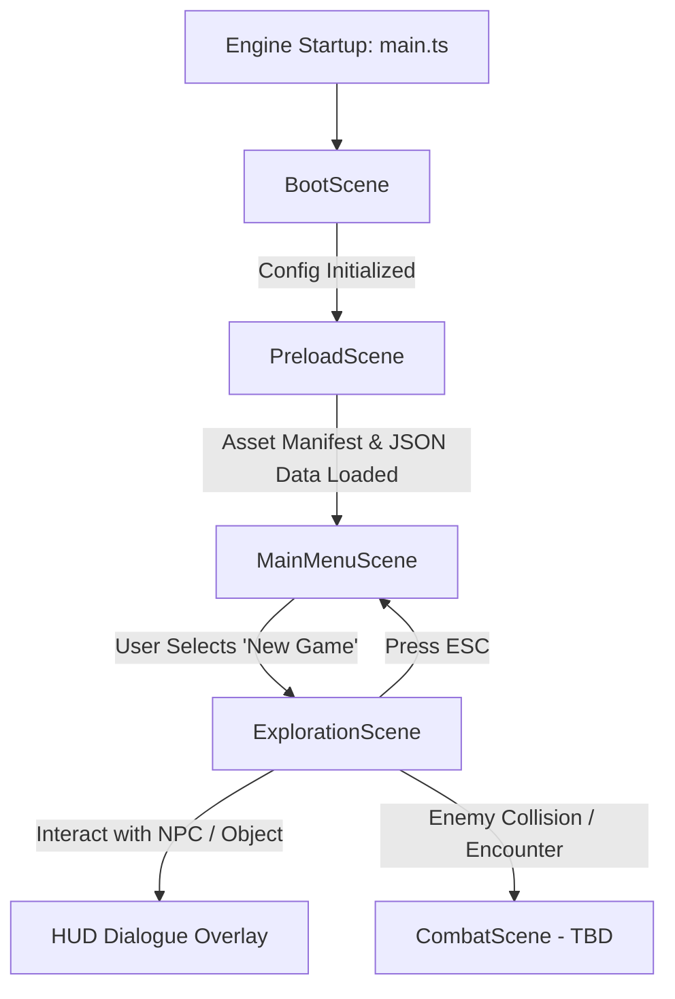

# CHRONO – THE FRACTURED DIVINITY
## Technical Design Document (TDD)

**Version:** 0.1.0-PROLOGUE  
**Target Platform:** Modern Desktop & Mobile Browsers (WebGL 2.0 / Canvas fallback)  
**Engine:** Phaser 3.88+  
**Language:** TypeScript 5.8+ (Strict Mode)  
**Bundler:** Vite 6+  

---

## 1. Architectural Principles

1. **Separation of Concerns:** Scene management, rendering, physics, and gameplay logic reside in independent, decoupled subsystems.
2. **Data-Driven Architecture:** Gameplay content (dialogues, quests, enemy stats, item definitions, and level layouts) is stored in external JSON schemas and never hardcoded in scene logic.
3. **Interface-Driven Decoupling:** All subsystems expose strict TypeScript interfaces (`IPlayerController`, `IMovementSystem`, `IInteractionSystem`, `IDialogueSystem`, etc.) enabling mocking, automated testing, and modular replacement.
4. **Deterministic Math & Movement:** Decoupled velocity and delta-time calculations ensure consistent character speed regardless of monitor refresh rate (60Hz, 120Hz, 144Hz).

---

## 2. Directory Layout

```
Chrono_workspace/
├── public/
│   └── assets/
│       ├── audio/            # WAV/OGG music and SFX
│       ├── characters/       # Player sprite sheets
│       ├── data/             # External JSON databases (dialogue, quests, items, enemies)
│       ├── effects/          # FX particles, visual impacts
│       ├── enemies/          # Combat and overworld enemy sprites
│       ├── maps/             # Tiled JSON level layouts
│       ├── npcs/             # Non-player character sprites
│       ├── tilesets/         # Environment tile sheets
│       └── ui/               # Dialogue frames, health bars, cursors
├── src/
│   ├── config.ts             # Phaser GameConfig & Canvas settings
│   ├── main.ts               # Application entry point
│   ├── entities/
│   │   ├── Entity.ts         # Base sprite wrapper
│   │   ├── Player.ts         # Player entity with controller & movement injection
│   │   └── NPC.ts            # Interactive world entities
│   ├── scenes/
│   │   ├── BootScene.ts      # Engine bootstrap
│   │   ├── PreloadScene.ts   # Manifest loader & loading bar
│   │   ├── MainMenuScene.ts  # Title screen & state selector
│   │   └── ExplorationScene.ts # Overworld exploration & collision
│   └── systems/
│       ├── combat/           # Turn-based combat system interfaces & models
│       ├── dialogue/         # Node-based dialogue graph system
│       ├── input/            # Input controllers (Keyboard, Gamepad [TBD])
│       ├── interaction/      # Spatial interactable query & dispatch
│       ├── inventory/        # Item definitions & inventory management
│       ├── movement/         # Top-down movement & direction logic
│       ├── quest/            # Objective tracking & stage machine
│       └── save/             # State serialization & LocalStorage provider
├── scripts/
│   ├── generate-assets.js    # Procedural placeholder asset generator
│   ├── generate-map.js       # Tiled JSON generator
│   └── test-gameplay.js      # Headless browser CDP integration test suite
├── index.html
├── tsconfig.json
├── vite.config.ts
├── package.json
├── ART_GUIDE.md
├── GDD.md
├── LORE.md
├── TECHNICAL_DESIGN.md
├── IMPLEMENTATION_ROADMAP.md
└── README.md
```

---

## 3. Scene Lifecycle & State Flow



1. **BootScene:** Configures canvas scale mode (`Phaser.Scale.FIT`), pixelArt rendering flags, and sets up global registry parameters.
2. **PreloadScene:** Emits visual progress updates, verifies and loads image textures, Tiled map JSONs, and external game data JSONs (`data_dialogue`, `data_quests`, `data_enemies`, `data_items`).
3. **MainMenuScene:** Manages user selection, keyboard navigation (`Up/Down/Enter/Space`), pointer clicks, and cinematic camera transitions (`fadeOut` / `fadeIn`).
4. **ExplorationScene:** Instantiates the tilemap layers, configures physics collision, mounts the `InteractionSystem`, and connects the `Player` with `KeyboardPlayerController` and `TopDownMovementSystem`.

---

## 4. Modular Subsystem Specifications

### 4.1 Input & Controller Layer (`IPlayerController`)
- **Interface:** `getMovementVector(): MovementDirection`, `getActions(): ControllerActions`, `setEnabled(flag: boolean)`.
- **Implementation:** `KeyboardPlayerController` binds WASD and Arrow keys for directional intent, Space/E for interaction, and ESC for cancellation/menu.
- **Decoupling:** Input intent returns a normalized vector `[-1..1, -1..1]` without directly modifying physics bodies.

### 4.2 Movement System (`IMovementSystem`)
- **Interface:** `move(target, direction, speed)`, `stop(target)`, `getFacing(direction)`.
- **Implementation:** `TopDownMovementSystem` normalizes diagonal movement vectors so diagonal velocity does not exceed straight-line speed ($\sqrt{dx^2 + dy^2}$). It manages 4-directional facing states (`up`, `down`, `left`, `right`).

### 4.3 Interaction System (`IInteractionSystem`)
- **Interface:** `IInteractable` requires `id`, `interactPrompt`, `getInteractionPosition()`, `getInteractionRadius()`, `canInteract()`, `onInteract()`.
- **Implementation:** `InteractionSystem` tracks all interactables in the current scene, performs spatial distance queries around the player, and returns closest candidates.

### 4.4 Dialogue System (`IDialogueSystem`)
- **Data Model:** Directed dialogue graph stored in `assets/data/dialogue.json`.
- **Interface:** `loadDatabase()`, `startDialogue(id)`, `advance()`, `selectOption(index)`, `getCurrentNode()`, `close()`.
- **Scene Decoupling:** Dialogue data is retrieved via the Phaser Cache and consumed without hardcoding strings into scene files.

### 4.5 Quest System (`IQuestSystem`)
- **Data Model:** Quests with stages (`inactive`, `started`, `completed`, `failed`), multi-objective trackers, and reward structures.
- **Interface:** `startQuest(id)`, `completeObjective(questId, objId)`, `completeQuest(id)`, `getActiveQuests()`.
- **Status:** Architecture interfaces and data models defined; state machine integration slated for Milestone 2.

### 4.6 Combat System (`ICombatSystem`)
- **Data Model:** Turn-based state machine with `BattlePhase` (`intro`, `turn_select`, `turn_execute`, `victory`, `defeat`, `escaped`), initiative order derived from speed stats, action descriptors (`attack`, `skill`, `item`, `defend`).
- **Interface:** `startBattle(party, enemies)`, `executeAction(action)`, `isBattleOver()`, `getState()`.
- **Status:** Interfaces and types established; full Turn-Based Battle Scene slated for Milestone 3.

### 4.7 Inventory System (`IInventorySystem`)
- **Data Model:** Items with categories (`consumable`, `equipment`, `material`, `key_item`), stack limits, and value fields.
- **Interface:** `addItem()`, `removeItem()`, `hasItem()`, `getAllItems()`, `getItemDefinition()`.
- **Status:** Interfaces and JSON schemas established.

### 4.8 Save System (`ISaveSystem`)
- **Data Model:** Serialized player coordinates, active scene key, inventory snapshot, quest states, and game flags.
- **Interface:** `save(slot, data)`, `load(slot)`, `delete(slot)`, `listSlots()`.
- **Storage Provider:** Browser `localStorage` (default), extensible to IndexedDB or remote server.

---

## 5. Collision & Physics Strategy

- **Physics Engine:** Arcade Physics configured with 0 gravity (`{ x: 0, y: 0 }`).
- **Map Collision:** Layer collision configured on the "Walls" layer using `setCollisionBetween(4, 16, true)` and tile property `{ collides: true }`.
- **Hitbox Tuning:** Player bounding box uses an 18×14 px footprint offset to `(7, 16)` on a 32×32 px sprite. This standard RPG bounding technique allows character heads/shoulders to overlap wall tops visually while stopping firmly at the base.

---

## 6. Verification & Automated Testing Harness

Testing utilizes a headless Chromium/Edge instance over the Chrome DevTools Protocol (`scripts/test-gameplay.js`):
1. **Scene Initialization:** Asserts that `PreloadScene` loads all assets and switches to `MainMenuScene`.
2. **Transition Execution:** Dispatches menu input and confirms `ExplorationScene` mounts.
3. **State Assertion:** Inspects player coordinates before and after simulated movement.
4. **Collision Verification:** Drives player against perimeter wall and checks physics blocking flags.
5. **Data-Driven Interaction:** Triggers interaction with `NPC Elder` and asserts external dialogue string rendering.
6. **Visual Inspection:** Captures automated screenshots at each milestone.

---

## 7. Unresolved Technical Items (Marked as TBD)

- **Audio Subsystem:** WebAudio vs. HTML5 Audio fallback under strict browser autoplay policies (TBD).
- **Gamepad / Touch Controls:** On-screen virtual joystick and d-pad layout for mobile screens (TBD).
- **Tilemap Streaming / Chunking:** Large world map chunk unloading for memory optimization in extended chapters (TBD).
- **Save State Encryption:** Obfuscation of save payloads in `localStorage` to deter tampering (TBD).

