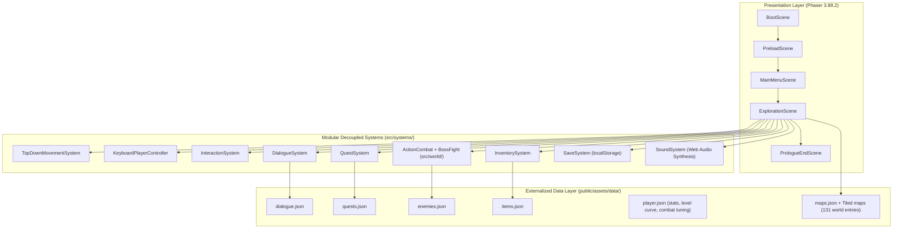
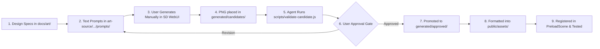

# CHRONO – THE FRACTURED DIVINITY

## Master Project Context & Architectural Source of Truth

**Document Version:** 1.1.0

**Project Lead:** Lead Technical Architect & Project Documentation Engineer  
**Canonical Status:** Authoritative Master Document for Antigravity & Claude Code  
**Date of Audit:** November 17, 2026 (runtime/status refresh; historical lore sections retained)

---

## 1. Project Vision & Core Identity

**CHRONO – THE FRACTURED DIVINITY** is an original, single-player browser-based 2D RPG crafted with classic 16-bit pixel art aesthetic, deliberate top-down exploration and real-time action combat on the maps (no battle scene). The game takes place in the melancholy, celestial aftermath of the Cataclysm of the Divided Hour—a cosmic rupture that shattered the flow of continuous time into localized distortions, recursive loops, and crystalline chronal anomalies.

### Current milestone

- **Scope:** Story complete: Prologue + Chapters 1-9, four endings, 131 maps (including hidden maps).
- **Delivery:** Browser RPG with exploration, dialogue, puzzles, quests, equipment, saves, real-time field enemies and real-time bosses on their own maps. Chapter selection covers all chapters.
- **Presentation:** LPC environments for chapters 0-5, approved 64x64 Peter animations, full neon void for chapters 6-9, per-map atmosphere/colour grade and a Be Vietnam Pro UI at 768×432. Owner playtesting and presentation upgrades continue; see `docs/TASKS.md`.

---

## 2. Game Genre & Gameplay Direction

| Aspect                      | Specification                                                                                                           | Confirmation Status        |
| :-------------------------- | :---------------------------------------------------------------------------------------------------------------------- | :------------------------- |
| **Development Environment** | Google Antigravity IDE (Primary Workspace)                                                                              | **CONFIRMED**              |
| **Remote Repository**       | `https://github.com/VanDuc1610/Chrono.git` (branch `main`)                                                              | **CONFIRMED**              |
| **Genre**                   | 2D Single-Player Turn-Based RPG                                                                                         | **CONFIRMED**              |
| **Platform**                | Modern Web Browsers (Desktop Chrome, Edge, Firefox, Safari)                                                             | **CONFIRMED**              |
| **Camera**                  | 2D Top-Down Orthographic (3/4 pitch, 640×360 native canvas scaled via `FIT`)                                            | **CONFIRMED**              |
| **Art Style**               | Authentic 16-bit Pixel Art with stylized proportions                                                                    | **CONFIRMED**              |
| **Atmosphere**              | Cosmic Dark Fantasy + Ethereal                                                                                          | **CONFIRMED**              |
| **Combat**                  | Real time on the map: field enemies and bosses (the turn-based scene was removed 2026-11-18)                            | **CONFIRMED**              |
| **Control Scheme**          | Keyboard (WASD / Arrows to move, Space/E to interact, 1-2 for choices, I/B for satchel, K for quick-save, ESC for menu) | **CONFIRMED**              |
| **Gamepad / Touch**         | Virtual touch controls and Gamepad API support                                                                          | _PROPOSED (Post-Prologue)_ |

---

## 3. Confirmed Technical Architecture

The technical stack was audited directly from repository code and verified via live automated headless browser test suites:



### Key Architectural Standards:

1. **Strict TypeScript Typing:** `tsconfig.json` enforces `strict: true`, `noUnusedLocals: true`, and zero implicit `any`.
2. **Decoupled System Boundaries:** All gameplay systems implement explicit interfaces (`IMovementSystem`, `IPlayerController`, `IInteractionSystem`, `IDialogueSystem`, `IQuestSystem`, `IInventorySystem`, `ISaveSystem`).
3. **Data-Driven Logic:** Scene files do not hardcode quest objectives, enemy or player stats, items, rewards, or dialogue scripts. All data is read from external JSON files in `public/assets/data/` (`player.json` holds Peter's base stats, per-level growth, EXP thresholds, starting items and combat formula tuning).
4. **Game State Lives in `GameSession` (`src/state/GameSession.ts`):** Inventory, quest progress, story flags, level/EXP/HP and playtime belong to one session object stored in the Phaser registry — never in scene fields, because Phaser reuses scene instances on every `scene.start()`. New Game creates a fresh session; Continue hydrates one from the save; scenes only read/write it. Scene listeners on long-lived systems (e.g. `QuestSystem`) must be removed on `SHUTDOWN`.
5. **Phaser Lifecycle Hygiene:** `ExplorationScene.init()` resets all scene-local transient state (UI arrays, timers) on every entry. Never stub the global `Math.random` in tests — Phaser uses it for texture UUIDs; inject an RNG instead.
6. **Procedural Web Audio Synthesis:** Sound effects are generated in `SoundSystem.ts` using the browser's native Web Audio API (`AudioContext`), avoiding copyrighted audio files.

---

## 4. Current Implementation Status (Audited Findings)

### 4.1 Completed runtime features (source-confirmed)

- **Story/world:** Prologue through Chapter 9, 131 entries in `maps.json`; four ending cards (`order`, `unbound`, `true`, `returned_page`) routed by `chapter9EndingKeys` in `PrologueEndScene.ts`.
- **Combat:** all real time on the maps: `ActionCombat` (field enemies) and `BossFight` with `src/systems/boss/` (bosses, profiles in `bosses.json`). Equipment has melee, ranged, armour and accessory slots.
- **Exploration/state:** branching dialogue, puzzle fields, quests, inventory, progression, chapter selection and save/load through GameSession. Scene state is reset and listeners cleaned up on shutdown.
- **Peter:** approved 64x64 LPC-scale animation sheets (`PeterAnimationConfig.ts`); Player preserves the 18x14 foot collider with a frame-specific origin/offset. Character identity remains governed by `docs/art/PETER_DESIGN.md`.
- **LPC environments:** `scripts/lpc/veridia.mjs` builds Veridia; `reskin.mjs` rebuilds chapter 0-5 tilesets slot for slot while retaining collision, puzzle swaps and story props. Pinned sources and derived atlases are attributed in the LPC manifests and root CREDITS.md.
- **Depth/presentation:** ActorShadows adds contact shadows and foot sorting; overlay/above layers support tall props; WallCaps draws LPC wall tops above actors. Atmosphere applies lights, motes, darkness and per-map multiply/screen grade.
- **Neon:** `NeonSkin` reads `neon.json` (an accent colour per map) and adds accents only: rings on points of interest, frames on exits and puzzle pieces. Every chapter is in LPC art; the full line-art void was retired (2026-11-18).
- **UI:** Be Vietnam Pro (SIL OFL, made for Vietnamese; replaced VT323 on 2026-11-18 for readability) through `crispText.ts` (scale 1.15, min 10 px); BootScene waits for font loading. The game draws at 768×432; maps smaller than the view are surrounded by their border tile (`MapSurround`). Compact HUD, quest tracker, dialogue and menus are under active T-91 polish.
- **Audio:** SoundSystem uses procedural Web Audio; new music/SFX and settings designs are tracked separately on the task board.

### 4.2 Verification and release (2026-11-17)

- `npm test`: **260 tests in 33 files passed**.
- Typecheck, production build and repository-wide Prettier check passed. Lint: no errors, one existing assertion-style warning in `tests/arsenal-boss.test.ts`.
- Production Chromium smoke passed in 10 seconds: menu boot, Enter/new game, nonblank rendered canvas, real-key movement, quick-save/reload, no page/console errors.
- Vite uses relative base `./`; game bundle is about 460 kB, Phaser vendor about 1,482 kB before gzip. Font path is resolved at runtime from `assets/fonts/`.
- `.github/workflows/ci.yml` retains all checks, builds once, tests the build and deploys its artifact with GitHub Pages actions. Play URL: https://vanduc1610.github.io/Chrono/ (requires Pages source set to GitHub Actions and a successful deployment).

### 4.3 Remaining work

Owner playtests, UI polish, audio, settings/pause/save UX and further per-map LPC dressing are tracked in `docs/TASKS.md`. Gamepad/touch, crafting and skill-tree proposals are not completion claims.

---

## 5. Confirmed Narrative & Lore Decisions

### 5.1 The Cataclysm of the Divided Hour

Before memory, time flowed as an unbroken celestial continuum governed by the **Divine Chronometer** maintained by the primordial architect **Chronos**. Without warning, the Great Fracture occurred, shattering the celestial mechanisms into countless **Chrono Shards**. Localities became trapped in recursive loops or accelerating decay.

### 5.2 Confirmed Characters & Roles

- **Peter (The Protagonist):**
  - An adult traveler awaking in the Shattered Antechamber.
  - Possesses innate resonance with chronal fractures and carries signature relics.
  - **Peter's True Identity:** Explicitly **UNWRITTEN** and left as an environmental mystery (_Confirmed Decision_).
- **Kuro, the Forgotten One:**
  - The main opposing antagonist across the overarching narrative (_Confirmed Decision_).
  - Representative of the discarded timelines and erased possibilities seeking to unravel the surviving continuum.
- **The Six Divine Authorities:**
  - The governing cosmic facets of the Fractured Divinity (_Confirmed Decision_):
    1. **Origin:** The spark of beginning and baseline genesis.
    2. **Continuum:** The unbroken forward progression of temporal flow.
    3. **Causality:** The inescapable law of cause, consequence, and paradox.
    4. **Memory:** The preservation of recorded events and emotional resonance.
    5. **Possibility:** The divergence of branching outcomes and untaken paths.
    6. **Finality:** The inevitable entropic conclusion and collapse of all hours.
- **Elder Chronographer:**
  - Monastic keeper of the Sanctuary of Moments, guiding resonated travelers.
- **Temporal Shades:**
  - Hostile apparitions coalescing from unspent, fractured moments.

### 5.3 Narrative Delivery Philosophy

Narrative delivery strictly emphasizes **environmental storytelling**, exploration, handwritten journal entries, memory fragments, and architectural inscriptions rather than expository lore dumps.

---

## 6. Peter Character Design Decisions

### 6.1 Approved Visual Baseline Assets

- **Master Concept Art:** `art-source/characters/peter/concept/peter_master_v1.png`
- **Alternate Pose Art:** `art-source/characters/peter/concept/peter_alt_pose_v1.png`
- **Turnaround Reference:** `art-source/characters/peter/concept/peter_concept_v1.png`
- **Design Specification:** `docs/art/PETER_DESIGN.md`
- **Master Prompt:** `art-source/characters/peter/prompts/peter_final_prompt_v1.txt`
- **Metadata Ledger:** `art-source/characters/peter/metadata/peter_design.json`

### 6.2 Non-Negotiable Hairstyle Permanent Identity Lock

Peter's hairstyle is a permanent character identity feature and **CANNOT** be modified without explicit project owner approval:

- **Style:** Short, compact, naturally curly men's haircut (`#3b291d`).
- **Texture:** Clearly distinguishable, tightly coiled, springy curls.
- **Silhouette:** Rounded, compact, and slightly elevated dome silhouette.
- **Growth:** Curls grow upward and outward rather than hanging down.
- **Coverage:** Complete curly hair coverage across entire head, crown, temples, sides, and nape.
- **STRICT PROHIBITIONS – Never interpret as:**
  - Straight messy hair.
  - Wavy hair.
  - Loose flowing curls.
  - Long curly fringe.
  - Drooping bangs.
  - Shaggy or layered hair.
  - Undercut, skin fade, or shaved sides/nape.
  - Ponytail, bun, or long hair.

### 6.3 Costume & Equipment Features

- **Coat:** Asymmetrical charcoal-blue travel duster (`#263248`) with high structured collar and 4 horizontal pairs of silver bar-and-toggle clasps. Restrained purple interior lining (`#281e36`) visible at cuffs and hem.
- **Strap:** Diagonal dark-brown leather harness strap (`#453123`) from left shoulder to right hip with silver buckle (per `peter_master_v1.png`).
- **Tunic & Trousers:** Dark vertically ribbed tunic shirt (`#12151d`), dark traveler trousers (`#181c24`), and dark oiled leather field boots (`#2e2219`) with turnover cuffs.
- **Face & Eyes:** Mature masculine facial proportions (~26 years old), light stubble along jawline, contemplative expression, muted gray-blue eyes (`#607d9c`).
- **Signature Objects:**
  1. _Broken Blade:_ Ancient broadsword fractured midway, glowing with cerulean fracture energy (`#00c8ff`) along the jagged break.
  2. _Stopped Watch:_ Ornate antique silver timepiece suspended from waist belt by silver chain.
  3. _Torn Notebook:_ Leather-bound field journal mounted to shoulder strap at right hip.

---

## 7. Approved Art Direction & Technical Standards

- **Perspective:** 2D Top-Down Orthographic (3/4 pitch, viewing angle $45^\circ\dots 60^\circ$).
- **Resolution:** Peter uses approved 64x64 LPC-scale frames; world tiles remain 32x32. Other sheets follow their individual preload/frame definitions.
- **Footprint Hitbox:** Peter retains an 18x14 foot collider; `PeterAnimationConfig.ts` and `Player.ts` define the current 64x64 origin and body offsets.
- **Ground Anchor:** Peter uses the LPC frame origin above the soles; consult the animation config rather than the historical 32x32 row convention.
- **Transparency:** Pure 8-bit RGBA transparency ($A = 0$ for background). No soft feathering, halos, or background color matte bleed.
- **Palette:** The 32-color Chronal Spectrum (The Abyss dark tones, Divine Fracture cerulean/cyan, Eternal Order brass/gold, Temporal Corruption violet/carmine). See `docs/art/ART_GUIDE.md`.

---

## 8. Art Pipelines

In accordance with `AGENTS.md` §5 and `.agents/rules/chrono-art.md`, art is produced through one of two pipelines that share the same approval gate:

- **Pipeline B – Code-Authored Pixel Art** (owner-approved 2026-11-11): the agent hand-places pixels in a committed script (e.g. `scripts/author-peter-lpc.js`, `scripts/author-monsters.js`, `scripts/author-bosses.js`), writes to `generated/candidates/` (+ `previews/`), validates, and the owner approves before integration. No image models or APIs.
- **Pipeline A – Manual AUTOMATIC1111** (below): the owner generates images manually from agent-authored text prompts.



### Governing Pipeline Rules:

1. Preserve approved character designs without alteration.
2. Prompts originate strictly from written text design documents.
3. Never search for external character references or copyrighted artwork.
4. Never use AI image models or run generation loops (code-authored pixel art under Pipeline B is not image generation).
5. Never connect to AUTOMATIC1111 API.
6. Never promote candidate assets without explicit user sign-off.

---

## 9. Development Conventions & File Locations

### 9.1 Key Directories

- `src/` – TypeScript application code (scenes, entities, systems).
- `public/assets/` – Runtime assets loaded by Phaser (only user-approved assets enter here).
- `public/assets/data/` – External game data JSONs (`dialogue.json`, `quests.json`, `enemies.json`, `items.json`).
- `art-source/` – Non-runtime art production assets:
  - `characters/peter/` – Master concepts, prompts, metadata, candidates, approved sheets.
  - `npcs/` – Non-player character art production.
  - `enemies/` – Enemy sprite production.
  - `environment/` – Tileset and map art production.
- `docs/` – Project design, art guides, technical specifications, and migration handoffs.
- `scripts/` – Test suites and asset validation utilities.

### 9.2 Coding Standards

- TypeScript 5.8 strict mode; ES2022 modules.
- Explicit interfaces for all systems.
- PascalCase for scene and class names (`ExplorationScene`, `PlayerController`).
- CamelCase for instance methods, variables, and properties.
- UPPER_SNAKE_CASE for constants.

---

## 10. Commands Reference

```bash
# 1. Install dependencies (Node.js >= 20 required, current: v24.22.1)
npm install

# 2. Run local development server (Vite on http://localhost:3000/)
npm run dev

# 3. Typecheck codebase with strict compiler
npm run typecheck

# 4. Production build (tsc + vite bundle into dist/)
npm run build

# 5. Preview production build
npm run preview

# 6. Execute live engine gameplay test (CDP automated test)
node scripts/test-gameplay.js

# 8. Execute inventory & save persistence test (CDP automated test)
node scripts/test-inventory-save.js

# 9. Validate candidate asset PNG against technical rubric
node scripts/validate-candidate.js <path-to-png>
```

---

## 11. Known Problems, Technical Debt & Unresolved Decisions

### Confirmed Decisions vs. Unresolved Decisions Ledger:

| Feature                     | Status                       | Notes                                                                                                                            |
| :-------------------------- | :--------------------------- | :------------------------------------------------------------------------------------------------------------------------------- |
| **Peter Character Design**  | **CONFIRMED**                | Master concept approved in `peter_master_v1.png`. Hairstyle locked.                                                              |
| **Peter True Origin**       | **UNRESOLVED (Intentional)** | Unwritten; delivered via environmental discovery.                                                                                |
| **Kuro, the Forgotten One** | **CONFIRMED**                | Established as main opposing character. Visual design: _UNRESOLVED_.                                                             |
| **Six Divine Authorities**  | **CONFIRMED**                | Origin, Continuum, Causality, Memory, Possibility, Finality established.                                                         |
| **Combat Mechanics**        | **CONFIRMED**                | Everything is fought in real time on the maps; the turn-based scene was removed (owner, 2026-11-18).                             |
| **EXP & Levelling**         | **CONFIRMED**                | In scope for the prologue (owner decision 2026-11-10). Curve/growth tunable in `player.json`.                                    |
| **Audio Architecture**      | **CONFIRMED**                | Procedural Web Audio synthesis (`SoundSystem.ts`). No copyrighted audio.                                                         |
| **Party System**            | _PROPOSED (TBD)_             | Peter is controlled directly; chapter companions and companion calls exist. General party switching remains a separate proposal. |
| **Git Repository**          | **RESOLVED & CONNECTED**     | Remote `origin` linked to `https://github.com/VanDuc1610/Chrono.git` on branch `main` at baseline `ffb72c3`.                     |

---

## 12. Next implementation work

Use `docs/TASKS.md` for assignments and file locks. Current priorities are owner review, UI polish, audio/settings design and per-map LPC dressing. No AI image generation or asset promotion without owner approval. Historical root screenshots now live in `docs/archive/screenshots/`; they do not represent the current presentation.
