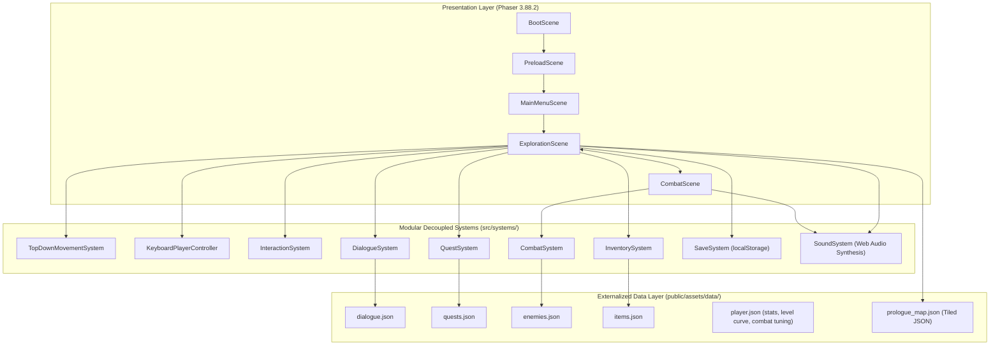

# CHRONO – THE FRACTURED DIVINITY

## Master Project Context & Architectural Source of Truth

**Document Version:** 1.0.0  
**Project Lead:** Lead Technical Architect & Project Documentation Engineer  
**Canonical Status:** Authoritative Master Document for Antigravity & Claude Code  
**Date of Audit:** November 10, 2026

---

## 1. Project Vision & Core Identity

**CHRONO – THE FRACTURED DIVINITY** is an original, single-player browser-based 2D RPG crafted with classic 16-bit pixel art aesthetic, deliberate top-down exploration, and tactical turn-based combat. The game takes place in the melancholy, celestial aftermath of the Cataclysm of the Divided Hour—a cosmic rupture that shattered the flow of continuous time into localized distortions, recursive loops, and crystalline chronal anomalies.

### Target Milestone:

- **Scope:** Playable **Prologue Vertical Slice** (estimated 10–15 minutes of gameplay).
- **Deliverable:** Fully functional browser experience demonstrating the complete gameplay loop: booting, title navigation, top-down exploration of an ancient sanctuary ruins, externalized dialogue with branching choices, quest tracking, satchel inventory management, persistent multi-slot save/load, and turn-based battle against a temporal anomaly with seamless overworld return.

---

## 2. Game Genre & Gameplay Direction

| Aspect                      | Specification                                                                                                           | Confirmation Status        |
| :-------------------------- | :---------------------------------------------------------------------------------------------------------------------- | :------------------------- |
| **Development Environment** | Google Antigravity IDE (Primary Workspace)                                                                              | **CONFIRMED**              |
| **Remote Repository**       | `https://github.com/VanDuc1610/Chrono.git` (branch `main`)                                                              | **CONFIRMED**              |
| **Genre**                   | 2D Single-Player Turn-Based RPG                                                                                         | **CONFIRMED**              |
| **Platform**                | Modern Web Browsers (Desktop Chrome, Edge, Firefox, Safari)                                                             | **CONFIRMED**              |
| **Camera**                  | 2D Top-Down Orthographic (3/4 pitch, 640×360 native canvas scaled via `FIT`)                                            | **CONFIRMED**              |
| **Art Style**               | Authentic 16-bit Pixel Art with stylized proportions                                                                    | **CONFIRMED**              |
| **Atmosphere**              | Cosmic Dark Fantasy + Ethereal                                                                                          | **CONFIRMED**              |
| **Combat**                  | Turn-based tactical battle arena with speed-based initiative queue                                                      | **CONFIRMED**              |
| **Control Scheme**          | Keyboard (WASD / Arrows to move, Space/E to interact, 1-2 for choices, I/B for satchel, K for quick-save, ESC for menu) | **CONFIRMED**              |
| **Gamepad / Touch**         | Virtual touch controls and Gamepad API support                                                                          | _PROPOSED (Post-Prologue)_ |

---

## 3. Confirmed Technical Architecture

The technical stack was audited directly from repository code and verified via live automated headless browser test suites:



### Key Architectural Standards:

1. **Strict TypeScript Typing:** `tsconfig.json` enforces `strict: true`, `noUnusedLocals: true`, and zero implicit `any`.
2. **Decoupled System Boundaries:** All gameplay systems implement explicit interfaces (`IMovementSystem`, `IPlayerController`, `IInteractionSystem`, `IDialogueSystem`, `IQuestSystem`, `ICombatSystem`, `IInventorySystem`, `ISaveSystem`).
3. **Data-Driven Logic:** Scene files do not hardcode quest objectives, enemy or player stats, items, rewards, or dialogue scripts. All data is read from external JSON files in `public/assets/data/` (`player.json` holds Peter's base stats, per-level growth, EXP thresholds, starting items and combat formula tuning).
4. **Game State Lives in `GameSession` (`src/state/GameSession.ts`):** Inventory, quest progress, story flags, level/EXP/HP and playtime belong to one session object stored in the Phaser registry — never in scene fields, because Phaser reuses scene instances on every `scene.start()`. New Game creates a fresh session; Continue hydrates one from the save; scenes only read/write it. Scene listeners on long-lived systems (e.g. `QuestSystem`) must be removed on `SHUTDOWN`.
5. **Phaser Lifecycle Hygiene:** `ExplorationScene.init()` and `CombatScene.init()` reset all scene-local transient state (UI arrays, timers, turn locks) on every entry. Never stub the global `Math.random` in tests — Phaser uses it for texture UUIDs; use `CombatSystem.setRandomSource()` instead.
6. **Procedural Web Audio Synthesis:** Sound effects are generated in `SoundSystem.ts` using the browser's native Web Audio API (`AudioContext`), avoiding copyrighted audio files.

---

## 4. Current Implementation Status (Audited Findings)

### 4.1 Completed Features (Verified on Live Engine)

- [x] **Project Foundation:** Phaser 3.88.2 + TypeScript 5.8 + Vite 6 build system (`npm run build` succeeds in <1s).
- [x] **Scene Lifecycle:** `BootScene` $\rightarrow$ `PreloadScene` $\rightarrow$ `MainMenuScene` $\rightarrow$ `ExplorationScene` $\rightarrow$ `CombatScene`.
- [x] **Exploration Mechanics:** 4-direction movement, Arcade Physics wall collision boundaries, smooth camera following with world constraints.
- [x] **Collision Footprint:** $18 \times 14\text{ px}$ foot collider at center-bottom `(7, 16)` enabling natural 2.5D depth sorting against vertical wall tiles.
- [x] **Dialogue Engine:** Typewriter text rendering, fast-forward skip on interact key, multi-choice branching (`dialogue.json`).
- [x] **Quest State Machine:** Objective tracking, banner notifications, top-right HUD tracker (`quests.json`).
- [x] **Turn-Based Combat:** Speed-ordered initiative queue, Temporal Strike costs MP (refilled each battle) (the faster combatant acts first each round), player command menu (Attack, Skill, Item, Defend, Escape), Defend lasts until the defender's next action, Item consumes a Chrono Shard from the satchel, Escape succeeds with probability `0.5 + 0.05 × (speed difference)` clamped to 10–90% (a failed escape costs the turn), floating damage numbers, victory/defeat resolution, EXP + loot-table rewards, dissolve tween, and overworld return.
- [x] **Prologue Arc & Ending:** "Echoes in the Fracture" → follow-up "Silence the Fracture" (defeat the Temporal Shade) → Elder farewell → `PrologueEndScene` closing card → title. Defeat revives Peter at the Altar of Moments with full HP (GDD §9 checkpoint revival).
- [x] **Peter Runtime Sprites:** idle + walk are approved code-authored art (`CHAR_PETER_002`); run / attack / hurt / temporal_sight remain placeholders.
- [x] **Progression:** EXP from enemies (`expReward`) and quest rewards; level thresholds and per-level stat growth in `player.json` (level cap 3 in the prologue, GDD §9); a level-up fully restores HP. HP persists between battles.
- [x] **Inventory System:** `InventorySystem` backing, signature starter items (Broken Chronometer, 2x Minor Chrono Shards), in-game Satchel overlay (`I`/`B`), consumable item usage in combat (not yet usable from the satchel in exploration).
- [x] **Save/Load Persistence:** Multi-slot `localStorage` persistence with in-memory fallback, Quick-Save (`K`), dynamic "CONTINUE" enablement on MainMenuScene, and 100% accurate coordinate/state restoration.
- [x] **Audio Synthesis:** `SoundSystem` providing 16-bit cursor blips, selection chimes, blade slash bursts, heal chords, save chimes, and volume/mute toggle options.
- [x] **Automated CDP Test Suites:** Three end-to-end headless browser test suites (`scripts/test-gameplay.js`, `scripts/test-combat.js`, `scripts/test-inventory-save.js`) and asset validation tool (`scripts/validate-candidate.js`).

### 4.2 Partially Implemented / Staged for Asset Replacement

- [ ] **Character Runtime Visuals:** Peter currently uses procedural $32 \times 32\text{ px}$ runtime spritesheets (`public/assets/characters/peter/`). Approved master concept art exists (`peter_master_v1.png`, `peter_alt_pose_v1.png`), but final AI sprite turnaround sheets are awaiting manual generation in AUTOMATIC1111.
- [ ] **NPC Sprites:** Elder Chronographer uses a temporary visual placeholder (`npc_elder_placeholder.png`). Written specification is complete (`docs/art/ELDER_DESIGN.md`).
- [ ] **Enemy Sprites:** Temporal Shade uses a temporary placeholder (`enemy_fracture_placeholder.png`).
- [ ] **Tileset Art:** Ruined sanctuary uses procedural placeholder tileset (`dungeon_tileset.png`).

### 4.3 Proposed / Not Implemented in Prologue

- Full world overworld map (_Proposed for Chapter 1_).
- Multi-character party switching (_Proposed for Chapter 1_).
- Complex skill trees and job/class progression (_Proposed for Chapter 2_).
- Equipment crafting and gear socketing (_Proposed for Chapter 2_).

---

## 5. Confirmed Narrative & Lore Decisions

### 5.1 The Cataclysm of the Divided Hour

Before memory, time flowed as an unbroken celestial continuum governed by the **Divine Chronometer** maintained by the primordial architect **Chronos**. Without warning, the Great Fracture occurred, shattering the celestial mechanisms into countless **Chrono Shards**. Localities became trapped in recursive loops or accelerating decay.

### 5.2 Confirmed Characters & Roles

- **Peter (The Protagonist):**
  - An adult traveler awaking in the Shattered Antechamber.
  - Possesses innate resonance with chronal fractures and carries signature relics.
  - **Peter's True Identity:** Explicitly **UNWRITTEN** and left as an environmental mystery (_Confirmed Decision_).
- **Kuro, the Forgotten One:**
  - The main opposing antagonist across the overarching narrative (_Confirmed Decision_).
  - Representative of the discarded timelines and erased possibilities seeking to unravel the surviving continuum.
- **The Six Divine Authorities:**
  - The governing cosmic facets of the Fractured Divinity (_Confirmed Decision_):
    1. **Origin:** The spark of beginning and baseline genesis.
    2. **Continuum:** The unbroken forward progression of temporal flow.
    3. **Causality:** The inescapable law of cause, consequence, and paradox.
    4. **Memory:** The preservation of recorded events and emotional resonance.
    5. **Possibility:** The divergence of branching outcomes and untaken paths.
    6. **Finality:** The inevitable entropic conclusion and collapse of all hours.
- **Elder Chronographer:**
  - Monastic keeper of the Sanctuary of Moments, guiding resonated travelers.
- **Temporal Shades:**
  - Hostile apparitions coalescing from unspent, fractured moments.

### 5.3 Narrative Delivery Philosophy

Narrative delivery strictly emphasizes **environmental storytelling**, exploration, handwritten journal entries, memory fragments, and architectural inscriptions rather than expository lore dumps.

---

## 6. Peter Character Design Decisions

### 6.1 Approved Visual Baseline Assets

- **Master Concept Art:** `art-source/characters/peter/concept/peter_master_v1.png`
- **Alternate Pose Art:** `art-source/characters/peter/concept/peter_alt_pose_v1.png`
- **Turnaround Reference:** `art-source/characters/peter/concept/peter_concept_v1.png`
- **Design Specification:** `docs/art/PETER_DESIGN.md`
- **Master Prompt:** `art-source/characters/peter/prompts/peter_final_prompt_v1.txt`
- **Metadata Ledger:** `art-source/characters/peter/metadata/peter_design.json`

### 6.2 Non-Negotiable Hairstyle Permanent Identity Lock

Peter's hairstyle is a permanent character identity feature and **CANNOT** be modified without explicit project owner approval:

- **Style:** Short, compact, naturally curly men's haircut (`#3b291d`).
- **Texture:** Clearly distinguishable, tightly coiled, springy curls.
- **Silhouette:** Rounded, compact, and slightly elevated dome silhouette.
- **Growth:** Curls grow upward and outward rather than hanging down.
- **Coverage:** Complete curly hair coverage across entire head, crown, temples, sides, and nape.
- **STRICT PROHIBITIONS – Never interpret as:**
  - Straight messy hair.
  - Wavy hair.
  - Loose flowing curls.
  - Long curly fringe.
  - Drooping bangs.
  - Shaggy or layered hair.
  - Undercut, skin fade, or shaved sides/nape.
  - Ponytail, bun, or long hair.

### 6.3 Costume & Equipment Features

- **Coat:** Asymmetrical charcoal-blue travel duster (`#263248`) with high structured collar and 4 horizontal pairs of silver bar-and-toggle clasps. Restrained purple interior lining (`#281e36`) visible at cuffs and hem.
- **Strap:** Diagonal dark-brown leather harness strap (`#453123`) from left shoulder to right hip with silver buckle (per `peter_master_v1.png`).
- **Tunic & Trousers:** Dark vertically ribbed tunic shirt (`#12151d`), dark traveler trousers (`#181c24`), and dark oiled leather field boots (`#2e2219`) with turnover cuffs.
- **Face & Eyes:** Mature masculine facial proportions (~26 years old), light stubble along jawline, contemplative expression, muted gray-blue eyes (`#607d9c`).
- **Signature Objects:**
  1. _Broken Blade:_ Ancient broadsword fractured midway, glowing with cerulean fracture energy (`#00c8ff`) along the jagged break.
  2. _Stopped Watch:_ Ornate antique silver timepiece suspended from waist belt by silver chain.
  3. _Torn Notebook:_ Leather-bound field journal mounted to shoulder strap at right hip.

---

## 7. Approved Art Direction & Technical Standards

- **Perspective:** 2D Top-Down Orthographic (3/4 pitch, viewing angle $45^\circ\dots 60^\circ$).
- **Resolution:** $32 \times 32\text{ px}$ per animation frame cell.
- **Footprint Hitbox:** $18 \times 14\text{ px}$ centered at $(X=7, Y=16)$ inside the $32 \times 32\text{ px}$ bounding box.
- **Ground Anchor:** Feet anchored on rows $Y = 28\dots 30$.
- **Transparency:** Pure 8-bit RGBA transparency ($A = 0$ for background). No soft feathering, halos, or background color matte bleed.
- **Palette:** The 32-color Chronal Spectrum (The Abyss dark tones, Divine Fracture cerulean/cyan, Eternal Order brass/gold, Temporal Corruption violet/carmine). See `docs/art/ART_GUIDE.md`.

---

## 8. Art Pipelines

In accordance with `AGENTS.md` §5 and `.agents/rules/chrono-art.md`, art is produced through one of two pipelines that share the same approval gate:

- **Pipeline B – Code-Authored Pixel Art** (owner-approved 2026-11-11): the agent hand-places pixels in a committed script (e.g. `scripts/author-peter-sprites.js`, palette from `docs/art/PETER_DESIGN.md`), writes to `generated/candidates/` (+ `previews/`), validates, and the owner approves before integration. No image models or APIs.
- **Pipeline A – Manual AUTOMATIC1111** (below): the owner generates images manually from agent-authored text prompts.


### Governing Pipeline Rules:

1. Preserve approved character designs without alteration.
2. Prompts originate strictly from written text design documents.
3. Never search for external character references or copyrighted artwork.
4. Never use AI image models or run generation loops (code-authored pixel art under Pipeline B is not image generation).
5. Never connect to AUTOMATIC1111 API.
6. Never promote candidate assets without explicit user sign-off.

---

## 9. Development Conventions & File Locations

### 9.1 Key Directories

- `src/` – TypeScript application code (scenes, entities, systems).
- `public/assets/` – Runtime assets loaded by Phaser (only user-approved assets enter here).
- `public/assets/data/` – External game data JSONs (`dialogue.json`, `quests.json`, `enemies.json`, `items.json`).
- `art-source/` – Non-runtime art production assets:
  - `characters/peter/` – Master concepts, prompts, metadata, candidates, approved sheets.
  - `npcs/` – Non-player character art production.
  - `enemies/` – Enemy sprite production.
  - `environment/` – Tileset and map art production.
- `docs/` – Project design, art guides, technical specifications, and migration handoffs.
- `scripts/` – Test suites and asset validation utilities.

### 9.2 Coding Standards

- TypeScript 5.8 strict mode; ES2022 modules.
- Explicit interfaces for all systems.
- PascalCase for scene and class names (`ExplorationScene`, `PlayerController`).
- CamelCase for instance methods, variables, and properties.
- UPPER_SNAKE_CASE for constants.

---

## 10. Commands Reference

```bash
# 1. Install dependencies (Node.js >= 20 required, current: v24.22.1)
npm install

# 2. Run local development server (Vite on http://localhost:3000/)
npm run dev

# 3. Typecheck codebase with strict compiler
npm run typecheck

# 4. Production build (tsc + vite bundle into dist/)
npm run build

# 5. Preview production build
npm run preview

# 6. Execute live engine gameplay test (CDP automated test)
node scripts/test-gameplay.js

# 7. Execute turn-based combat test (CDP automated test)
node scripts/test-combat.js

# 8. Execute inventory & save persistence test (CDP automated test)
node scripts/test-inventory-save.js

# 9. Validate candidate asset PNG against technical rubric
node scripts/validate-candidate.js <path-to-png>
```

---

## 11. Known Problems, Technical Debt & Unresolved Decisions

### Confirmed Decisions vs. Unresolved Decisions Ledger:

| Feature                     | Status                       | Notes                                                                                                            |
| :-------------------------- | :--------------------------- | :--------------------------------------------------------------------------------------------------------------- |
| **Peter Character Design**  | **CONFIRMED**                | Master concept approved in `peter_master_v1.png`. Hairstyle locked.                                              |
| **Peter True Origin**       | **UNRESOLVED (Intentional)** | Unwritten; delivered via environmental discovery.                                                                |
| **Kuro, the Forgotten One** | **CONFIRMED**                | Established as main opposing character. Visual design: _UNRESOLVED_.                                             |
| **Six Divine Authorities**  | **CONFIRMED**                | Origin, Continuum, Causality, Memory, Possibility, Finality established.                                         |
| **Combat Mechanics**        | **CONFIRMED**                | Turn-based loop, speed initiative, 5 commands, probabilistic escape, victory/defeat (owner decision 2026-11-10). |
| **EXP & Levelling**         | **CONFIRMED**                | In scope for the prologue (owner decision 2026-11-10). Curve/growth tunable in `player.json`.                    |
| **Audio Architecture**      | **CONFIRMED**                | Procedural Web Audio synthesis (`SoundSystem.ts`). No copyrighted audio.                                         |
| **Party System**            | _PROPOSED (TBD)_             | Solo protagonist in Prologue. Multi-party deferred to Chapter 1.                                                 |
| **Git Repository**          | **RESOLVED & CONNECTED**     | Remote `origin` linked to `https://github.com/VanDuc1610/Chrono.git` on branch `main` at baseline `ffb72c3`.     |

---

## 12. Next Recommended Implementation Tasks

1. **Git Repository Remote:** Connected to `https://github.com/VanDuc1610/Chrono.git` on branch `main`. Stage and push new art guides and handoff docs.
2. **VS Code Workspace Migration:** Complete the handoff checklist to open the exact project folder in Visual Studio Code.
3. **Manual AI Sprite Generation for Peter:** User generates 4-direction idle and walk candidate sheets in AUTOMATIC1111 WebUI using `peter_idle.txt` and `peter_walk.txt`.
4. **NPC Elder & Enemy Sprite Production:** User generates candidate art for Elder Chronographer and Temporal Shade using authored prompt templates.
5. **Tilemap Art Polish:** Replace procedural placeholder dungeon tiles with the approved dark slate sanctuary tileset.
