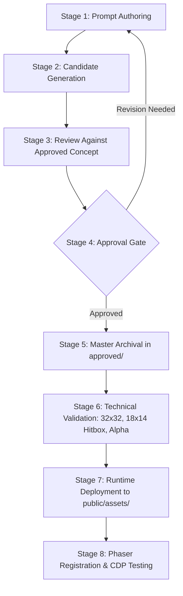

# CHRONO – SPRITE PRODUCTION PIPELINE

**Document Version:** 1.0.0  
**Scope:** Top-Down 16-Bit Character Sprite Sheets & Animations  
**Governing Rules:** [AGENTS.md](../../AGENTS.md) and [.agents/rules/chrono-art.md](../../.agents/rules/chrono-art.md)  
**Approved Baseline Reference:** `art-source/characters/peter/concept/peter_concept_v1.png`

---

## 1. Overview & Pipeline Stages

Every sprite integrated into **CHRONO – The Fractured Divinity** passes through an 8-stage verification pipeline to guarantee visual consistency, pixel precision, and strict compliance with approved design documents.



---

## 2. Directory Structure & File Movement

```
CHRONO/
│
├── art-source/characters/peter/
│   ├── concept/
│   │   └── peter_concept_v1.png          # Canonical reference (READ-ONLY)
│   ├── prompts/
│   │   ├── peter_base.txt                # Baseline character creative prompt
│   │   ├── peter_idle.txt                # 4-direction idle generation prompt
│   │   └── peter_walk.txt                # 4-direction walk generation prompt
│   ├── metadata/
│   │   └── peter_design.json             # Design specs and version ledger
│   └── generated/
│       ├── candidates/                   # Work-in-progress raw outputs
│       └── approved/                     # Formal approved master assets
│
├── docs/art/
│   ├── ART_GUIDE.md                      # Palette and pixel art standards
│   ├── PETER_DESIGN.md                   # Character design specification
│   └── SPRITE_PIPELINE.md                # This pipeline documentation
│
└── public/assets/characters/peter/       # Deployed runtime spritesheets
    ├── peter_idle.png                    # 128x128 px (4x4 frames)
    ├── peter_walk.png                    # 192x128 px (6x4 frames)
    ├── peter_run.png                     # 192x128 px (6x4 frames)
    └── peter_attack.png                  # 192x128 px (6x4 frames)
```

---

## 3. Technical Sprite Standards

### 3.1 Dimensions & Grid

- **Frame Size:** $32 \times 32\text{ px}$ strictly uniform across all animation frames.
- **Directional Rows (Standard 4 Cardinal Directions):**
  - **Row 0 ($Y = 0\dots 31$):** Down-facing (`down`) – Facing camera
  - **Row 1 ($Y = 32\dots 63$):** Up-facing (`up`) – Facing away
  - **Row 2 ($Y = 64\dots 95$):** Left-facing (`left`) – Profile left
  - **Row 3 ($Y = 96\dots 127$):** Right-facing (`right`) – Profile right

### 3.2 Footprint Collision Hitbox

- **Hitbox Dimensions:** $18 \times 14\text{ px}$.
- **Hitbox Offset:** $(X = 7, Y = 16)$ inside the $32 \times 32\text{ px}$ bounding box.
- **Visual Depth Principle:** Characters' feet are firmly grounded on rows $28\dots 29$. The head and upper torso naturally overlap vertical wall tiles to maintain 2.5D visual depth.

### 3.3 Transparency & Alpha Channel

- **Alpha:** Pure 8-bit RGBA transparency ($A = 0$ for empty canvas).
- **No Stray Pixels:** No partial-transparency fringe pixels, anti-aliased feathering, or background color bleed.

---

## 4. Animation Specifications

| Animation Set              | Frames per Dir | Total Frames | Spritesheet Size           | Target FPS | Description                                   |
| -------------------------- | -------------- | ------------ | -------------------------- | ---------- | --------------------------------------------- |
| **`peter_idle`**           | 4              | 16           | $128 \times 128\text{ px}$ | 5 FPS      | Subtle breathing, blade chronal fracture hum  |
| **`peter_walk`**           | 6              | 24           | $192 \times 128\text{ px}$ | 9 FPS      | Grounded stride, coat tail response, arm sway |
| **`peter_run`**            | 6              | 24           | $192 \times 128\text{ px}$ | 12 FPS     | Forward lean, dynamic coat flutter            |
| **`peter_attack`**         | 6              | 24           | $192 \times 128\text{ px}$ | 12 FPS     | Blade arc with cerulean chronal trail         |
| **`peter_hurt`**           | 2              | 8            | $64 \times 128\text{ px}$  | 10 FPS     | Recoil frame, white silhouette flash          |
| **`peter_temporal_sight`** | 4              | 16           | $128 \times 128\text{ px}$ | 6 FPS      | Channeled stance, eyes & blade intense glow   |

---

## 5. Review & Approval Protocol

Before any candidate sprite is promoted from `candidates/` to `approved/` and deployed to `public/assets/`:

1. **Hairstyle Audit (Permanent Identity Lock):**
   - Confirm short, compact, naturally curly men's haircut with clearly distinguishable, tightly coiled, springy curls.
   - Overall silhouette must be rounded, compact, and slightly elevated, with curls growing upward and outward rather than hanging down.
   - Complete visible curly coverage across the entire head, including sides and back.
   - Strictly verify **NO** straight messy hair, wavy hair, loose flowing curls, long curly fringe, drooping bangs, shaggy/layered hair, undercut, or shaved sides.
2. **Color Consistency Audit:** Sample pixel colors against the official palette in [PETER_DESIGN.md](PETER_DESIGN.md) (Charcoal-blue `#263248`, curly dark-brown `#3b291d`, cerulean glow `#00c8ff`, restrained purple accents `#281e36`).
3. **Accessories Audit:** Verify diagonal leather strap from left shoulder to right hip, right hip notebook, right-hand Broken Blade, and waist stopped watch.
4. **Frame Alignment Audit:** Verify anchor position does not drift between animation frames.
5. **Engine Verification:** Test in Phaser with Arcade physics collider and 4-way movement.
